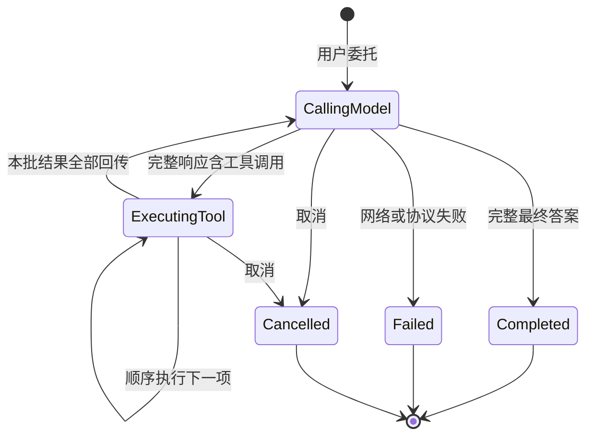
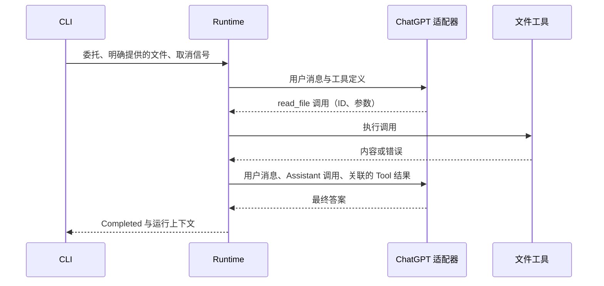

# Agent Runtime

## 当前范围

本版交付可独立运行和测试的 Rust 单 Agent Loop：一次用户委托，使用 ChatGPT 套餐额度调用模型，按顺序执行工具并回传结果，直到得到答案、失败或取消。CLI `run` 是测试入口；Web UI 仍提供工程基础页面。

执行状态和上下文只保存在内存中。首个工具是 `read_file`，只读取用户通过 `--read FILE` 明确提供的 UTF-8 文件，不写文件或执行命令。[产品文档](product.md) 中的会话、权限模式、成果、知识与远程交互留到对应能力阶段；本版不实现审批等待、运行中追加消息、并行工具、执行持久化、上下文压缩、插件、多 Agent 或工作流。

## 职责与契约

| 模块 | 职责与边界 |
| --- | --- |
| `src/runtime.rs` | 拥有执行顺序、工具结果关联与终止语义；定义模型和工具的最小调用契约、运行事件及结果。没有 HTTP、CLI 或 UI 依赖。 |
| `src/chatgpt_auth/` | 登录、验证身份与授权、保存和刷新凭据、撤销会话；不依赖 Runtime 或 UI。 |
| `src/chatgpt.rs` | 将核心消息与工具定义转换为官方 Responses API 请求，收集并校验完整流式响应；解释提供商续接数据。 |
| `src/tools.rs` | 定义和执行当前只读文件工具，检查调用参数及明确提供的文件范围。 |
| `src/main.rs` | 解析 CLI、发起登录与退出、组装模型与工具，把 Ctrl-C 转为取消信号，把运行结果转为输出和退出码。 |

`Model::complete` 接收上下文及工具定义，返回完整 `AssistantMessage<Model::Continuation>` 或错误。`Tools::definitions` 发布实际可执行的工具；`Tools::execute` 接收一个 `ToolCall`，返回文本结果或工具错误。这两个契约同时用于真实实现与确定性测试替身，不构建通用插件注册体系。

核心消息为 `User`、`Assistant`、`Tool`，没有提供商的 role 字段或 UI 协议。`AssistantMessage` 包含可选文本、工具调用和适配器定义的续接数据；调用包含 ID、名称及原始 JSON 参数；`ToolResult` 包含调用 ID、内容和 `is_error`。工具参数的 JSON schema 属于工具定义，具体参数由工具解析。

`Model::Continuation` 是由模型适配器定义的关联类型，Loop 只保留并回传，不解释其格式。确定性替身可使用 `()`；ChatGPT 适配器使用 Responses 输出项，保留工具调用及加密推理内容，供下一轮请求使用。提供商格式留在适配器，既不成为工具契约，也不成为未来会话或 UI 的模型。

## 一次执行

工具调用失败仍生成结果，继续同批剩余调用，再交给模型决定下一步。模型自行修正参数属于正常循环，不是 Runtime 自动重试。没有默认次数上限；需要结束尚未完成的委托时取消。

Runtime 在执行整批工具前检查调用 ID 非空且在本批内唯一；未知工具不会被分派，生成明确的错误结果。每项调用完成后立即把结果追加到上下文，全部完成后才发起下一次模型请求。工具顺序等于模型返回的顺序，部分失败不会跳过其他项。

`RunOutcome` 只有 `Completed`、`Failed`、`Cancelled`。最终响应没有答案和工具调用时失败；适配器把截断等未完成响应视为失败，不把部分答案当作成功。网络或协议失败不重试。

取消与当前模型或工具 future 竞争，信号已就绪时优先取消。取消会丢弃等待中的 future，停止后续工具和模型调用，保留已经提交到内存上下文的结果。不能据此承诺远端推理停止、文件读取的底层任务立即停止或副作用回滚。未来添加写入或进程工具时，必须先定义它们的取消和收尾契约。

本版不支持继续一个中断的运行。再次执行 `run` 发起新委托，不能直接把取消后的不完整工具批次当作下一次模型输入。

## 上下文、记录与展示

`RunReport` 返回最终结果及本次运行的模型上下文，便于检查。它不是会话历史、持久执行日志或恢复快照。完整工具结果进入本次上下文，没有默认摘要或截断；上下文过长导致 API 失败时明确报错，预算与压缩另行设计。

`RunEvent` 通知模型开始与完成、工具开始与完成、运行结束。事件是同步回调中的借用数据，CLI 用它显示进展；它不承担存储、重放或客户端传输协议。核心事实不依赖终端渲染。接入 Web 时再定义可读取状态和展示数据的转换，不预建广播、重连或历史回放接口。

## ChatGPT 登录与模型调用

采用官方 Sign in with ChatGPT 的本地开放源码客户端流程，直接调用 `https://api.openai.com/v1/responses`；不读取 Codex 的凭据、不使用 ChatGPT 内部 endpoint，也不接入 Codex app-server 或 TypeScript DevKit。符合条件的 Plus / Pro 用户授权后使用已有 Codex / ChatGPT Work 额度；不是 API key 计费或新增额度。当前为预览接口，具体模型可用性由账户决定。

`login` 先持久保存稳定 host ID、启动 `127.0.0.1` 的 `/auth/callback` 监听，再用系统浏览器完成 OAuth。首次通过 `dynamic_agent_client` 取得 issued client ID，后续沿用注册。每次使用新的 state、nonce 与 PKCE S256；校验回调关联、ID token 签名、issuer、audience、有效期、nonce 及账户身份，确认实际授予 `chatgpt.tokens.use.direct` 权限。只有身份登录不代表可调用模型。

登录数据保存在仓库外、仅当前用户可读写的文件中，原子替换 access token、refresh token 和到期信息。凭据到期后刷新；凭据操作互斥，避免并发刷新同一个旋转 token。`logout` 撤销 renewable session 后清理本地 token，保留 client 与 host 注册信息。撤销失败时保留登录并报错。网络或授权失败明确报错，不自动重试登录、切换账号或改用 API key。本版只管理一个账号。

`models` 读取已登录账户的可见模型 ID，`run --model MODEL` 明确选择；列表本身不保证一次请求一定获准，成功完成请求才验证该次访问。请求使用 `store: false`、`stream: true`，由客户端提供本次完整上下文，不使用远端 conversation 或 `previous_response_id`。工具定义放在 `rig` namespace 中，调用结果按 `call_id` 关联。

适配器接收 SSE，只有收到成功的 `response.completed` 才向 Loop 返回文本和完整工具调用；流中失败、未完成或意外断开均结束本次执行，不执行半截工具调用。Responses 的输出项留作续接数据，包含加密推理内容，下一轮与工具结果一起回传。暂不把 token 增量提供给 CLI 或 Web UI。HTTP 客户端关闭自动重试和重定向，不引入自定义超时策略。

登录凭据的保存只解决账号授权和 token 刷新，不提供任务持久化、运行恢复或对 ChatGPT 会话和记忆的访问。

`--read` 在启动时解析成规范绝对文件路径，工具定义列出可读路径，执行时只接受这些路径。模型无法用其他路径扩大读取范围。这是本版的明确文件选择契约，不是操作系统隔离；不承诺阻止运行期间外部修改文件或替换符号链接。

## 取舍与验证

选择自研显式循环，便于直接 review 模型、工具和取消如何推进。图驱动或持久执行 Runtime 可以组织复杂等待与恢复，SDK 可以减少提供商或调度实现，但会增加尚未需要的状态、依赖和语义映射。本版用两个实际可测试的调用边界保持模块独立，暂不引入这些机制。

验收关注完整行为：

- 确定性模型和工具验证多轮调用、顺序、结果 ID、部分失败及正常结束。
- 网络或协议错误结束执行，不产生隐式重试；无效的调用 ID 不触发工具。
- 在模型等待、工具等待及同批工具之间取消，后续工作不启动，已完成结果保留。
- 本地 HTTP 测试检查实际请求格式、工具结果回传、鉴权错误及响应结束原因。
- 临时真实文件测试验证明确提供的文件可读，其他路径和无效参数返回错误。
- CLI 检查凭据缺失、文件准备错误与帮助；合成登录、身份校验、凭据权限、刷新和退出测试；真实 ChatGPT 验证直接回答及读取文件后再次调用模型。真实验证需维护者完成浏览器授权，CI 不依赖账号。

实现可按登录凭据、模型适配、工具实现、Runtime 行为测试独立分工，共同依赖 `runtime.rs` 的契约；CLI 集成依赖真实模型与工具，最终工程检查由集成负责人完成。修改调用契约时同步行为测试、适配器和本文。

## 一手依据

资料核实日期：2026-10-12。

- [ChatGPT 官方登录协议](https://developers.openai.com/siwc/token-sharing-open-source/sign-in)、[凭据与刷新](https://developers.openai.com/siwc/token-sharing-open-source/profiles-and-sessions)：动态注册、PKCE、身份验证、授权范围与凭据管理。
- [模型调用](https://developers.openai.com/siwc/token-sharing-open-source/models-and-inference)、[预览限制](https://developers.openai.com/siwc/token-sharing-open-source/preview-limitations)、[推理上下文](https://developers.openai.com/api/docs/guides/reasoning)：官方地址、流式终止、工具格式及无远端存储的上下文回传。
- [Pi 执行循环](https://github.com/earendil-works/pi/blob/ce950d78f424dcaf9f5d6a03ce80ab141130eb1d/packages/agent/src/agent-loop.ts)：直接推进模型和工具的参考。本版没有采用其运行中消息、扩展和会话机制。
- [DSH 工具调度](https://github.com/deepseek-ai/deepseek-harness/blob/5badb15009ae1756c3afe0ae0cef1faafc290ccc/packages/core/agent-loop/src/tool-calls.ts)：工具结果与调度边界的参考。本版采用顺序执行。
